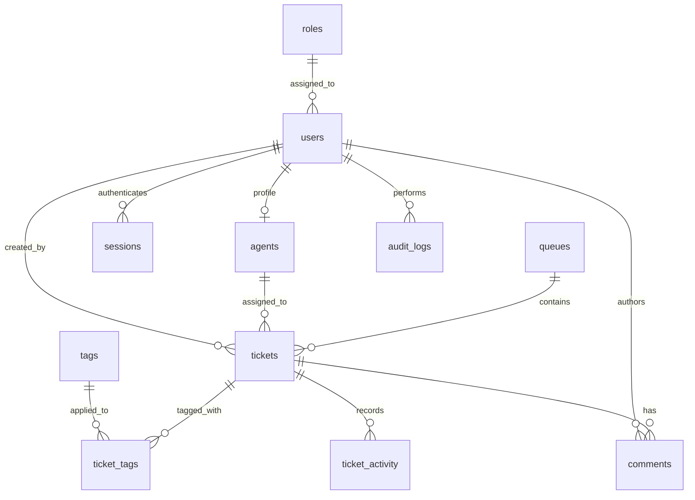

# Database Schema & Entity-Relationship Diagram

## Baseline Performance Characteristics

By design, `database/migrations/001_initial_schema.sql` omits composite filtering/sorting indexes and trigram text-search indexes on `tickets`, and `apps/api/src/repositories/ticket.repository.ts` executes an exact `SELECT COUNT(*)::int` alongside paginated data retrieval. This preserves realistic baseline bottlenecks for subsequent `EXPLAIN (ANALYZE, BUFFERS)` investigation.
