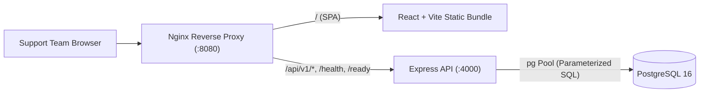

# System Architecture

QueueDesk is structured as a modular monolith with an npm workspaces monorepo separating the React frontend (`apps/web`), Express REST API (`apps/api`), and shared contracts (`packages/shared`).

## Key Layers

1. **Presentation (`apps/web`)**: React 18, TanStack Query for server state, TanStack Table for server-paginated ticket listing, React Hook Form + Zod for client validation.
2. **API (`apps/api`)**: Express middleware pipeline (Helmet, CORS, rate-limiting, `x-request-id`, Pino HTTP logging, JWT/session authentication, RBAC permission guards, Zod request validation) -> Controllers -> Services -> Repositories.
3. **Shared (`packages/shared`)**: Single source of truth for Zod validation schemas, TypeScript DTOs, and RBAC permission matrices.
4. **Database (`database/`)**: Versioned SQL migrations tracked in `schema_migrations` and a deterministic synthetic data generator.
